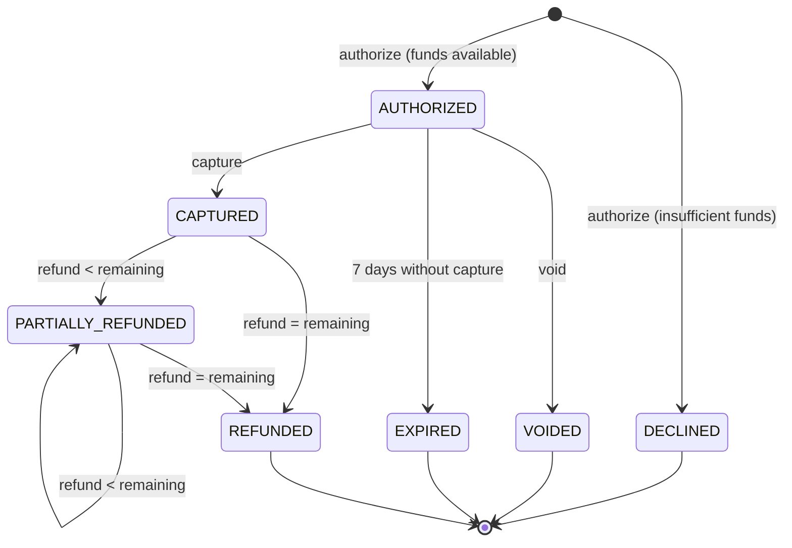
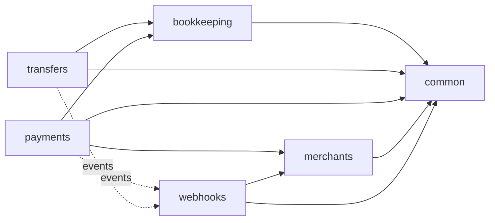
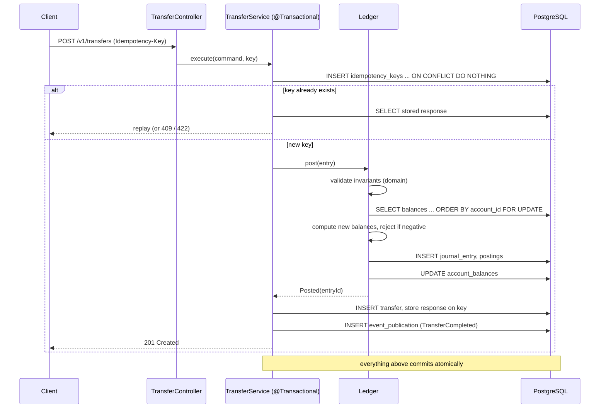

# ledger

A double-entry ledger with a payments API on top: customer wallets,
account-to-account transfers, a card-style payment flow (authorize, capture,
void, refund) for merchants, and signed webhooks.

It's built as a **modular monolith** on Java 25, Spring Boot 4.2,
Spring Modulith and PostgreSQL. The main design goal is correctness under
concurrency:

- Balances can never be wrong.
- Retrying a request never moves money twice.
- Two concurrent requests can never spend the same money.
- Every cent can be traced back to an immutable journal entry.

---

## Contents

1. [Concepts](#concepts)
2. [Domain rules](#domain-rules)
3. [Chart of accounts](#chart-of-accounts)
4. [Worked example 1: deposit and transfer](#worked-example-1-deposit-and-transfer)
5. [Worked example 2: payment lifecycle](#worked-example-2-payment-lifecycle)
6. [Architecture](#architecture)
7. [How the core works](#how-the-core-works)
8. [Data model](#data-model)
9. [API](#api)
10. [Webhooks](#webhooks)
11. [Testing strategy](#testing-strategy)
12. [Design decisions](#design-decisions)
13. [Roadmap (v1)](#roadmap-v1)
14. [Getting started](#getting-started)

---

## Concepts

| Term | Meaning |
|---|---|
| **Account** | A ledger account holding money in exactly one currency, such as Catalin's EUR wallet or the platform's fee revenue. |
| **Journal entry** | One atomic business event in the ledger, such as "transfer #42 executed". It contains two or more postings and is never modified after it's written. |
| **Posting** | One line of a journal entry: an account, a direction (`DEBIT` or `CREDIT`) and a positive amount. |
| **Balance** | The net of all postings on an account, oriented to the account's normal side (see below). It's stored for fast reads and can always be recomputed from the postings. |
| **Hold** | Money reserved by a payment authorization. It has left the customer's available balance but hasn't reached the merchant yet. |
| **Transfer** | A movement between two customer wallets, or a deposit or withdrawal against the outside world. |
| **Payment** | A merchant charging a customer: authorize, then capture or void, then optionally refund. |
| **Idempotency key** | A client-chosen unique key sent with every money-moving request. A retry with the same key returns the original result instead of executing again. |

### Debits and credits

Every account has a **normal side**:

| Category | Normal side | Increased by | Example |
|---|---|---|---|
| Asset | Debit | Debit | Money the platform holds at its partner bank |
| Liability | Credit | Credit | Money the platform owes a customer or merchant |
| Revenue | Credit | Credit | Fees the platform has earned |

Customer wallets are **liabilities** from the platform's point of view: if
Catalin has 100 EUR in his wallet, the platform owes Catalin 100 EUR. Crediting his
wallet increases his balance, and debiting it decreases it.

Each journal entry debits and credits equal amounts. Because of that, the books
always satisfy **Assets = Liabilities + Revenue** (plus Equity, which v1 doesn't
use), and the sum of all debits always equals the sum of all credits.

---

## Domain rules

### Money

- Amounts are stored as a **`long` count of minor units** (cents) together with
  an **ISO 4217 currency code**: `2599 EUR` means 25.99 EUR. Never `double` or
  `float`.
- The number of decimal places comes from the currency
  (`java.util.Currency#getDefaultFractionDigits`): EUR and RON have 2, JPY has 0.
- Supported currencies are configured. v1 supports `EUR`, `USD` and `RON`.
- Operations on two amounts in different currencies fail. **There is no
  currency conversion in v1.**
- The only place rounding happens is fee calculation. The rule there is
  **`HALF_EVEN`** (banker's rounding) to the currency's minor unit, computed with
  `BigDecimal` and converted back to minor units.

### Ledger

1. A journal entry has **at least two postings**.
2. Every posting amount is **strictly positive**. The direction says which way
   the money moves, so amounts are never negative.
3. For each currency in an entry, the **sum of debits equals the sum of credits**.
4. A posting's currency equals its account's currency.
5. Journal entries and postings are **append-only**. The code never updates or
   deletes them, and database triggers reject `UPDATE`, `DELETE` and `TRUNCATE`.
   Mistakes are corrected by posting a **reversal entry**.
6. Every entry has a unique **reference** such as `payment:{id}:capture`. A
   second attempt to post the same reference is rejected, which makes the
   ledger itself idempotent no matter what the caller does.
7. Accounts flagged `allowNegative = false`, which is every account in v1, can
   never go below zero. A posting that would cause that is **rejected as a
   whole**.

### Payments

- Fees are `percentage x amount` (rounded `HALF_EVEN`) `+ fixed`, using the
  merchant's fee schedule. The fee is **calculated and stored at authorization
  time**, so changing the schedule later never affects existing payments.
- An authorization whose amount is less than or equal to its fee is rejected.
- v1 supports **full capture only**. Refunds can be partial, but their total can
  never exceed the captured amount.
- **Refunds don't return the fee.** The merchant bears it.
- Authorizations that aren't captured within **7 days** expire and are released
  automatically.

### Time and identifiers

- All timestamps are UTC: `Instant` in Java, `timestamptz` in PostgreSQL and
  ISO-8601 with `Z` in JSON.
- Primary keys are random **UUIDs** (version 4, `UUID.randomUUID()`), generated
  in Java so that an object has its ID before it is saved. They are unguessable,
  so they are safe to use in URLs. Ordering always uses timestamps
  (`posted_at`, `created_at`), never IDs.
- In Java, identifiers are typed records (`AccountId`, `PaymentId`, ...), never
  a bare `UUID` or `String`.

---

## Chart of accounts

| Account | Code | Category | Normal side | Owner |
|---|---|---|---|---|
| Customer wallet | - | Liability | Credit | One per customer per currency |
| Merchant balance | - | Liability | Credit | One per merchant per currency |
| Authorization holds | `platform.holds.<CCY>` | Liability | Credit | Platform |
| Platform cash | `platform.cash.<CCY>` | Asset | Debit | Platform. Mirrors the money at the partner bank |
| Fee revenue | `platform.fees.<CCY>` | Revenue | Credit | Platform |

System accounts are created per supported currency by a Flyway migration.

---

## Worked example 1: deposit and transfer

Catalin and Bob each open an EUR wallet. Catalin deposits 100.00 EUR from his bank,
then sends 25.00 EUR to Bob.

### Step 1: deposit

`POST /v1/deposits` (operator)

| Posting | Account | Debit | Credit |
|---|---|---:|---:|
| 1 | Platform cash EUR | 100.00 | |
| 2 | Catalin wallet EUR | | 100.00 |

The platform now holds 100 EUR more at the bank (asset up) and owes Catalin
100 EUR (liability up).

### Step 2: transfer

```http
POST /v1/transfers
Idempotency-Key: 6f1c2a9e-1b7d-4c55-9c1e-2f3d4b5a6c7d
Content-Type: application/json

{
  "source_account_id": "0193a1b2-...-catalin",
  "destination_account_id": "0193a1b2-...-bob",
  "amount": { "value": 2500, "currency": "EUR" },
  "description": "Dinner"
}
```

```http
HTTP/1.1 201 Created

{
  "id": "0193a1c4-...",
  "status": "completed",
  "amount": { "value": 2500, "currency": "EUR" },
  "journal_entry_id": "0193a1c4-...",
  "created_at": "2026-11-24T15:21:07.412Z"
}
```

| Posting | Account | Debit | Credit |
|---|---|---:|---:|
| 1 | Catalin wallet EUR | 25.00 | |
| 2 | Bob wallet EUR | | 25.00 |

| Account | Balance after |
|---|---:|
| Platform cash EUR | 100.00 |
| Catalin wallet EUR | 75.00 |
| Bob wallet EUR | 25.00 |

The books balance: assets (100.00) = liabilities (75.00 + 25.00).

### What happens when things go wrong

| Situation | Result |
|---|---|
| The client times out and retries with the **same key and body** | `201` with the **stored original response**. No second entry is posted. |
| The client reuses the key with a **different body** | `422 idempotency-key-reused`. Nothing is posted. |
| Two requests with the same key arrive **at the same time** | The second one waits for the first to commit, then receives the stored response. |
| Catalin sends two **different** 60.00 EUR transfers at the same time | Both lock Catalin's balance row, so one runs after the other. The second sees 15.00 EUR and gets `422 insufficient-funds`. |
| Catalin -> Bob and Bob -> Catalin run at the same time | Balance rows are always locked in ascending account-ID order, so there's no deadlock. |

---

## Worked example 2: payment lifecycle

Catalin (75.00 EUR after example 1) pays 25.99 EUR at Coffee Shop. Coffee Shop's
fee schedule is **1.4% + 0.25 EUR**.

### Payment state machine



Any transition not shown here, such as capturing a voided payment, returns
`409 invalid-state-transition`.

### Step 1: authorize 25.99 EUR

```http
POST /v1/payments
Authorization: Bearer sk_test_...
Idempotency-Key: 9b2e...

{
  "customer_account_id": "0193a1b2-...-catalin",
  "amount": { "value": 2599, "currency": "EUR" },
  "description": "Flat white and croissant"
}
```

The fee is calculated now and stored on the payment:

```
2599 * 0.014 = 36.386  -> HALF_EVEN -> 36
36 + 25 (fixed)        = 61 minor units = 0.61 EUR
```

The money moves into the holds account. It's no longer spendable by Catalin, but
it doesn't belong to the merchant yet.

| Posting | Account | Debit | Credit |
|---|---|---:|---:|
| 1 | Catalin wallet EUR | 25.99 | |
| 2 | Authorization holds EUR | | 25.99 |

If Catalin had less than 25.99 EUR, the ledger would reject the entry. The
payment would still be stored with status `DECLINED`, and nothing would be
posted.

### Step 2: capture

`POST /v1/payments/{id}/capture`

This is a single entry with three postings. It settles the merchant and
recognizes the fee atomically.

| Posting | Account | Debit | Credit |
|---|---|---:|---:|
| 1 | Authorization holds EUR | 25.99 | |
| 2 | Coffee Shop balance EUR | | 25.38 |
| 3 | Fee revenue EUR | | 0.61 |

The debits (25.99) equal the credits (25.38 + 0.61).

> **Alternative, void:** if the merchant voided instead, the entry would be
> Dr Authorization holds 25.99 / Cr Catalin wallet 25.99. Expiry posts the same
> entry.

### Step 3: partial refund of 10.00 EUR

`POST /v1/payments/{id}/refunds` with `{"amount": {"value": 1000, "currency": "EUR"}}`

| Posting | Account | Debit | Credit |
|---|---|---:|---:|
| 1 | Coffee Shop balance EUR | 10.00 | |
| 2 | Catalin wallet EUR | | 10.00 |

The payment becomes `PARTIALLY_REFUNDED`, with 15.99 EUR still refundable.

### Books after both examples

| Account | Category | Balance |
|---|---|---:|
| Platform cash EUR | Asset | 100.00 |
| Catalin wallet EUR | Liability | 59.01 |
| Bob wallet EUR | Liability | 25.00 |
| Coffee Shop balance EUR | Liability | 15.38 |
| Authorization holds EUR | Liability | 0.00 |
| Fee revenue EUR | Revenue | 0.61 |

**Assets 100.00 = Liabilities 99.39 + Revenue 0.61.** The holds account is
zero because no authorization is open. In general, its balance must always
equal the sum of all `AUTHORIZED` payments, and the integrity check verifies
this.

### Rounding reference (1.4% fee)

| Amount | Exact fee | `HALF_EVEN` | `HALF_UP` would give |
|---:|---:|---:|---:|
| 2599 | 36.386 | 36 | 36 |
| 1250 | 17.5 | 18 | 18 |
| 1750 | 24.5 | **24** | 25 |

`HALF_EVEN` rounds exact halves to the nearest even number. Over many payments
this avoids the systematic upward bias of `HALF_UP`.

---

## Architecture

### Modular monolith

The application is one deployable unit split into **application modules**. The
module boundaries are verified on every build by Spring Modulith
(`ModularityTests`).

Microservices aren't used, for three reasons:

- One team owns the whole system, and that team is me. Microservices solve coordination problems between teams, and there's no one to coordinate with.
- Moving money requires **strong consistency**: a payment's state change and
  its journal entry must commit in **one database transaction**.
- Distributed transactions or sagas would add failure modes without solving a
  real problem at this scale.

Side effects that don't need to be atomic, like webhooks, are already decoupled
through events, so they're the natural first candidates for extraction later.

### Modules



| Module | Responsibility | Depends on |
|---|---|---|
| `common` | `Money`, Problem Details error handling, idempotency support. This is an *open* module. | - |
| `bookkeeping` | Accounts, journal entries, postings, balances, integrity checks. The core of the system. | `common` |
| `transfers` | Deposits, withdrawals and wallet-to-wallet transfers. | `bookkeeping` |
| `merchants` | Merchants, fee schedules, API keys and webhook endpoint configuration. | `common` |
| `payments` | The payment state machine, holds, fees, refunds and expiry. | `bookkeeping`, `merchants` |
| `webhooks` | Turns domain events into signed HTTP deliveries with retries. | `merchants`, and event types from `payments` and `transfers` |

Rules:

- **Calls that move money are synchronous** and run in the caller's
  transaction. For example, `payments` calls the `bookkeeping` facade directly.
- **Side effects are asynchronous events.** For example, `PaymentCaptured`
  triggers a webhook. Events are written to the Spring Modulith **event
  publication registry** in the same transaction as the business change (a
  transactional outbox). They're delivered after commit and re-delivered after
  a crash.
- `bookkeeping` knows nothing about transfers or payments. It only sees journal
  entries with references.
- There are no dependency cycles.

### Package layout

In Spring Modulith, **only the types in a module's base package are public**.
Every sub-package is internal. Other modules use the facade, commands, results
and events, and never entities or repositories.

```
org.codeberg.edryal.ledger
|-- common/                 # Money, error handling, idempotency (open module)
|-- bookkeeping/            # public API: Ledger facade, commands, results, IDs, exceptions
|   |-- domain/             # pure Java model and invariants, no Spring
|   |-- application/        # LedgerService, transactions
|   |-- infrastructure/     # repositories (JdbcClient, plain SQL)
|   `-- web/                # REST endpoints
|-- transfers/
|-- merchants/
|-- payments/
`-- webhooks/
```

Only `bookkeeping` uses a hexagonal split (`domain` / `application` /
`infrastructure`), because that's where the complex invariants are. The other
modules are organized by feature, with fewer layers.

Typed IDs live in the module that owns them: `AccountId` and `JournalEntryId`
in `bookkeeping`, `PaymentId` in `payments`, and so on.

### Bookkeeping facade

```java
public interface Ledger {
    AccountId open(OpenAccount command);
    Money balanceOf(AccountId id);
    AccountId systemAccount(SystemAccount account, Currency currency);
    PostResult post(PostEntry command);      // Posted | Rejected
}

public sealed interface PostResult {
    record Posted(JournalEntryId entryId) implements PostResult {}
    record Rejected(RejectionReason reason, AccountId accountId) implements PostResult {}
}
```

Business rejections like insufficient funds come back as a **value, not an
exception**. If they were thrown, Spring would mark the shared transaction
rollback-only, and the caller couldn't record a `DECLINED` payment in the same
transaction. Programming errors, such as an unbalanced entry, still throw, and
so does a duplicate reference (`DuplicateReferenceException`).

System accounts have random IDs, so callers look them up by kind and currency:
`ledger.systemAccount(SystemAccount.CASH, EUR)` finds `platform.cash.EUR`.

---

## How the core works

### Posting an entry



Steps inside `Ledger.post`:

1. **Validate** the entry in the domain model: at least two postings, positive
   amounts, debits equal credits per currency.
2. **Load and lock** the balance rows of all involved accounts with
   `SELECT ... FOR UPDATE`, **ordered by account ID**. The consistent order means
   two transactions can never wait on each other in a cycle, so there are no
   deadlocks.
3. **Check** account currencies and compute the new balances. If an account
   with `allowNegative = false` would go below zero, return `Rejected` before
   anything is written.
4. **Insert** the journal entry and its postings, and **update** the balances.
5. A `CHECK (allow_negative OR balance >= 0)` constraint on `account_balances`
   is a **backstop**: if a bug ever skipped step 3, the database would still
   refuse the write.

For each posting, the balance changes by `+amount` when the posting direction
equals the account's normal side, and by `-amount` otherwise.

### Idempotency

- The key is scoped per client: `(client_id, key)` is unique.
- The stored record contains a **SHA-256 hash of the request** (method, path
  and body), the response status and the response body.
- The key is inserted **in the same transaction** as the business change, using
  `INSERT ... ON CONFLICT DO NOTHING`. A concurrent request with the same key
  blocks on the unique index until the first one commits, then reads the
  stored response.
- Only committed outcomes are stored. If a request fails with `422
  insufficient-funds`, the whole transaction rolls back, including the key, so a
  retry is evaluated again. A declined payment *is* a committed outcome and is
  replayed.
- Keys expire after 24 hours and are removed by a scheduled cleanup job.

The journal-entry `reference` unique constraint is a second, independent
safety net.

### Concurrent state changes on a payment

Payments carry a JPA `@Version`. If a capture and a void race on the same
payment, the first one wins. The second fails with an optimistic-lock conflict
and is mapped to `409 concurrent-modification`. The ledger never sees a second
entry, because the losing transaction rolls back as a whole.

### Integrity checks

These are exposed as an Actuator health contributor (`/actuator/health/ledger`)
and asserted in tests:

1. Every journal entry balances, per currency.
2. Every stored balance equals the balance recomputed from postings.
3. Per currency, assets equal liabilities plus revenue (trial balance).
4. The authorization holds balance equals the sum of `AUTHORIZED` payments.

---

## Data model

Core tables (simplified):

```
accounts
  id               uuid pk
  code             text unique null          -- system accounts: platform.cash.EUR
  type             text                      -- CUSTOMER_WALLET, MERCHANT_BALANCE, ...
  category         text                      -- ASSET, LIABILITY, REVENUE
  currency         char(3)
  owner_id         uuid null
  created_at       timestamptz
  unique (id, currency)                      -- target of the postings FK below

account_balances
  account_id       uuid pk fk -> accounts
  balance          bigint                    -- minor units, normal-side oriented
  allow_negative   boolean
  updated_at       timestamptz
  CHECK (allow_negative OR balance >= 0)

journal_entries                              -- append-only (trigger)
  id               uuid pk
  reference        text unique               -- transfer:{id}, payment:{id}:capture
  description      text
  posted_at        timestamptz

postings                                     -- append-only (trigger)
  id               uuid pk
  entry_id         uuid fk -> journal_entries
  account_id       uuid
  direction        text                      -- DEBIT | CREDIT
  amount           bigint  CHECK (amount > 0)
  currency         char(3)
  fk (account_id, currency) -> accounts (id, currency)   -- rule 4 in the database
  posted_at        timestamptz               -- copied from the entry
  index (account_id, posted_at, id)          -- account statements, newest first

idempotency_keys
  client_id, key   pk
  request_hash     bytea
  response_status  int
  response_body    jsonb
  created_at       timestamptz
```

Module tables:

- transfers: `transfers`
- merchants: `merchants`, `fee_schedules`, `api_keys` (hashed)
- payments: `payments` (amount, fee, status, captured/refunded totals, `version`), `payment_refunds`
- webhooks: `webhook_endpoints`, `webhook_deliveries`
- Spring Modulith: `event_publication`

Each module owns its tables. No module queries another module's tables
directly.

---

## API

All endpoints are versioned under `/v1`. JSON uses `snake_case`.

Money is always `{"value": <long minor units>, "currency": "<ISO 4217>"}`.
Using integers avoids floating-point parsing in clients.

### Endpoints

| Method | Path | Caller | Idempotency key |
|---|---|---|---|
| `POST` | `/v1/accounts` | operator | - |
| `GET` | `/v1/accounts/{id}` | operator | - |
| `GET` | `/v1/accounts/{id}/postings?cursor=` | operator | - |
| `GET` | `/v1/journal-entries/{id}` | operator | - |
| `POST` | `/v1/deposits` | operator | required |
| `POST` | `/v1/withdrawals` | operator | required |
| `POST` | `/v1/transfers` | operator | required |
| `GET` | `/v1/transfers/{id}` | operator | - |
| `POST` | `/v1/merchants` | operator | - |
| `POST` | `/v1/payments` | merchant | required |
| `GET` | `/v1/payments/{id}` | merchant | - |
| `POST` | `/v1/payments/{id}/capture` | merchant | required |
| `POST` | `/v1/payments/{id}/void` | merchant | required |
| `POST` | `/v1/payments/{id}/refunds` | merchant | required |
| `PUT` | `/v1/webhook-endpoint` | merchant | - |
| `POST` | `/v1/webhook-deliveries/{id}/retry` | merchant | - |

### Authentication

- **Operators** (back office, internal services): OAuth2 JWTs issued by
  Keycloak, authorized with roles.
- **Merchants**: API keys (`Authorization: Bearer sk_test_...`). Keys are shown
  once at creation and stored as a hash.
- In v1, the merchant identifies the customer by their wallet account ID. This
  stands in for card details or a tokenized payment method.

### Errors

Errors follow RFC 9457 Problem Details (`application/problem+json`):

```json
{
  "type": "/problems/insufficient-funds",
  "title": "Insufficient funds",
  "status": 422,
  "detail": "Account 0193a1b2-... has 15.00 EUR available, 60.00 EUR required.",
  "instance": "/v1/transfers"
}
```

| Status | Problem types |
|---|---|
| 400 | `validation-failed`, `missing-idempotency-key` |
| 401 / 403 | `unauthenticated`, `forbidden` |
| 404 | `not-found` |
| 409 | `invalid-state-transition`, `concurrent-modification`, `duplicate-reference` |
| 422 | `insufficient-funds`, `currency-mismatch`, `idempotency-key-reused`, `refund-exceeds-captured`, `amount-below-fee` |

---

## Webhooks

Domain events produce merchant notifications:

- `payment.authorized`
- `payment.declined`
- `payment.captured`
- `payment.voided`
- `payment.expired`
- `payment.refunded`

```http
POST https://merchant.example/hooks
Content-Type: application/json
Ledger-Signature: t=1764000000,v1=5f2b6c...

{
  "id": "0193a1d0-...",
  "type": "payment.captured",
  "created_at": "2026-11-24T15:30:00Z",
  "data": {
    "payment_id": "0193a1c9-...",
    "amount": { "value": 2599, "currency": "EUR" },
    "fee":    { "value": 61,   "currency": "EUR" },
    "net":    { "value": 2538, "currency": "EUR" }
  }
}
```

### Signing

`v1 = hex(HMAC-SHA256(secret, t + "." + raw_body))`.

The receiver recomputes the signature, compares it in constant time, and
rejects timestamps older than 5 minutes to prevent replays.

### Delivery

- An `@ApplicationModuleListener` runs after commit in its own transaction and
  creates a `webhook_deliveries` row.
- A scheduled dispatcher claims due deliveries with
  `FOR UPDATE SKIP LOCKED`, so several instances can run safely. It sends them
  **outside** the database transaction, with a 10-second timeout.
- Any `2xx` response is success. Anything else, including timeouts, is retried
  with **exponential backoff and jitter**: 30s, 1m, 2m, 4m, ... for up to 10
  retries (about 8.5 hours in total).
- After the last retry the delivery becomes `DEAD`, which is the dead-letter
  state. The merchant can trigger it again manually.
- Delivery is **at least once**. Receivers deduplicate on the event `id`.

---

## Testing strategy

| Level | What | How |
|---|---|---|
| Domain | `Money`, `JournalEntry` invariants, fee rounding, payment state machine | Plain JUnit and AssertJ, no Spring, milliseconds per test |
| Module | Each module in isolation | Spring Modulith `@ApplicationModuleTest` with Testcontainers PostgreSQL |
| Architecture | Module boundaries, no cycles | `ModularityTests` (`ApplicationModules.verify()`) |
| Integration | Full HTTP flows, idempotent replays, Problem Details | `@SpringBootTest` + `RestTestClient` + Testcontainers |
| Concurrency | No double-spend, no deadlocks | N threads doing random transfers between M accounts, then asserting every integrity check and that no balance is negative |
| Database | Append-only trigger, `CHECK` constraints | Tests that try forbidden `UPDATE`/`DELETE` and expect them to fail |

---

## Design decisions

| Decision | Alternatives | Why |
|---|---|---|
| Modular monolith | Microservices | One team, ACID across ledger and payments, simpler operations. Event-based modules can be extracted later. |
| `long` minor units | `BigDecimal`, `NUMERIC` | Exact, fast, no scale or `equals` pitfalls, maps 1:1 to JSON integers. `BigDecimal` is used only for intermediate fee math. |
| Stored balances + pessimistic row locks, ordered by account ID | Computing balances from postings on read, or optimistic locking | Reads cost O(1). Optimistic retries would thrash on busy wallets. Ordered locking prevents deadlocks. |
| Append-only entries + reversals | Updating rows | Full audit trail, history can be reproduced, and corrections are visible. |
| Plain SQL (`JdbcClient`) for the ledger, JPA for payments | JPA everywhere | Ledger tables are append-only and need explicit `FOR UPDATE` ordering, so JPA adds nothing there. Payments are mutable aggregates with optimistic locking, which is what JPA is good at. |
| Synchronous ledger calls, async events for side effects | Event-driven ledger updates | Money movement must be atomic with business state. Notifications don't need to be. |
| Result type for business rejections | Exceptions | Keeps the transaction usable so declines can be recorded. |
| Idempotency key in the business transaction | Separate "in-progress" record | One atomic commit, no orphaned keys, and the database resolves concurrent duplicates. |
| Holds via a liability account | A separate "reserved" column on the wallet | Every movement stays double-entry and appears in statements. |

### Known limitations

- **Hot system accounts.** Every payment locks `platform.holds` and
  `platform.fees`, which serializes payments per currency. Possible fixes:
  sharded sub-accounts, or not keeping a locked running balance for system
  accounts.
- No FX, partial captures, chargebacks, disputes or merchant payouts beyond
  withdrawals.
- Customers have no direct API. Transfers go through an operator or a trusted
  internal service.

---

## Roadmap (v1)

### M1 - Bookkeeping core

- [x] `Money` in `common` and typed IDs in `bookkeeping`, with unit tests
- [x] Domain: `Direction`, `AccountCategory`, `Posting`, `JournalEntry`, with invariant tests
- [x] Flyway `V2`: accounts, balances, journal entries, postings, append-only trigger, system accounts
- [x] `Ledger` facade: `Account`, open account, post entry (ordered locking), balance
- [ ] Account, statement (cursor pagination) and journal-entry endpoints
- [ ] Problem Details error handling
- [ ] Integrity checks and the `ledger` health contributor

### M2 - Funding and transfers

- [ ] Idempotency support in `common`
- [ ] Deposits, withdrawals and transfers
- [ ] Concurrency test: no double-spend, no deadlocks, integrity holds

### M3 - Merchants and payments

- [ ] Merchants, fee schedules and hashed API keys
- [ ] Payment aggregate and state machine, with fees calculated at authorization
- [ ] Authorize, decline, capture, void and refunds, all through the ledger
- [ ] Scheduled authorization expiry
- [ ] Domain events through the event publication registry

### M4 - Webhooks

- [ ] Endpoint configuration and signing secrets
- [ ] Delivery dispatcher with `SKIP LOCKED`, backoff, `DEAD` state and manual retry

### M5 - Security and docs

- [ ] Keycloak in `compose.yaml`, JWT roles for operators, API-key filter chain for merchants
- [ ] OpenAPI documentation
- [ ] Architecture decision records in `docs/adr/`

### After v1

Kafka externalization of events, transaction monitoring (fraud rules), daily
reconciliation against bank statements, OpenTelemetry metrics and tracing,
FX, and partial captures.

---

## Getting started

Requirements: JDK 25 and a running Docker daemon.

```sh
./mvnw spring-boot:run   # starts PostgreSQL from compose.yaml automatically
./mvnw test              # unit, module and integration tests (Testcontainers)
```

Running `ModularityTests` generates module diagrams into `target/spring-modulith-docs`.

Ports, database access, debugging and migrations: [docs/development.md](docs/development.md).

## Tech stack

Java 25, Spring Boot 4.2, Spring Modulith 2.2, Spring Data JPA / Hibernate,
`JdbcClient`, PostgreSQL 18, Flyway, Spring Security (OAuth2 Resource
Server, Keycloak), Testcontainers, JUnit, AssertJ
