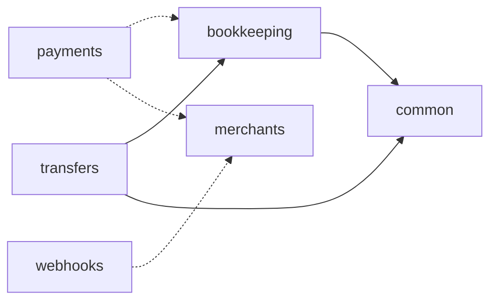
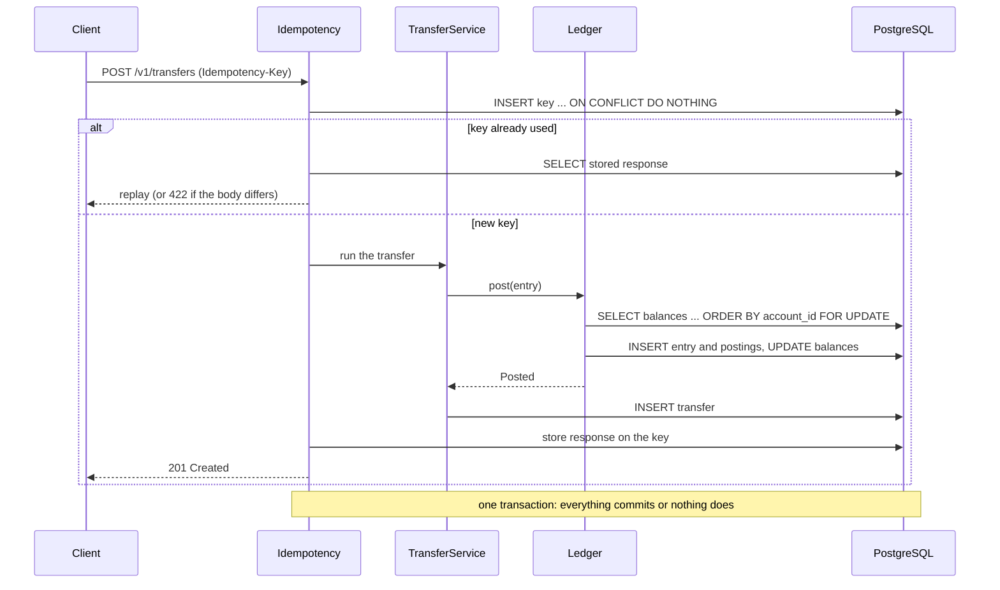
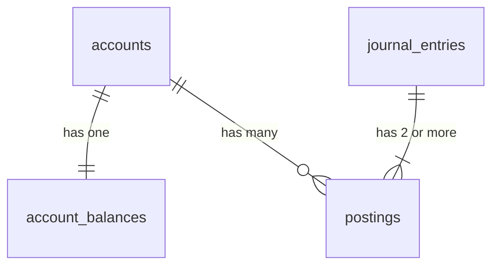

# Architecture

How the code is organized, how the core works, and why it's built this way.

## Modular monolith

The application is one deployable split into **modules**. Spring Modulith checks
the boundaries on every build (`ModularityTests`): if a module uses another
module's internals, the build fails.

It's not split into microservices because moving money and recording why it
moved must happen in **one database transaction**. Across services that would
need distributed transactions or sagas, which add failure modes without solving
a real problem at this size. Side effects that don't need to be atomic, like
webhooks, will go through events, so they're the natural first candidates to
split out later.

## Modules



Dashed lines are planned.

| Module | Responsibility | Status |
|---|---|---|
| `common` | `Money`, JSON shapes for money, Problem Details helper, idempotency keys. Every module may use it. | done |
| `bookkeeping` | Accounts, journal entries, postings, balances, statements, integrity checks. Knows nothing about transfers or payments, only entries with references. | done |
| `transfers` | Deposits, withdrawals and transfers between accounts. | done |
| `merchants` | Merchants, fee schedules, API keys, webhook settings. | planned |
| `payments` | The payment state machine, holds, fees, refunds, expiry. | planned |
| `webhooks` | Turns payment events into signed HTTP calls with retries. | planned |

Rules between modules:

- **Moving money is a direct call** inside the caller's transaction. `transfers`
  calls the `Ledger` interface and waits for the result.
- **Side effects will be events** *(planned)*, stored in the same transaction
  (transactional outbox) and delivered after commit.
- No dependency cycles. Each module owns its tables and never reads another
  module's tables.

## Package layout

In Spring Modulith, **only the types in a module's top package are public**.
Every sub-package is internal to the module.

```
org.codeberg.edryal.ledger
|-- common/                 # Money, plus web/ and idempotency/ (open to all modules)
|-- bookkeeping/            # public API: Ledger, commands, results, IDs, exceptions
|   |-- domain/             # pure Java model and rules, no Spring
|   |-- application/        # LedgerService, LedgerQueries, integrity checks
|   |-- infrastructure/     # repositories (JdbcClient, plain SQL)
|   `-- web/                # REST endpoints
`-- transfers/              # everything in one package, most classes package-private
```

Only `bookkeeping` has the full split into domain, application and
infrastructure, because that's where the complex rules are. Smaller modules
keep everything in one package.

## The Ledger API

Other modules use `bookkeeping` only through this interface:

```java
public interface Ledger {
    AccountId open(OpenAccount command);
    Money balanceOf(AccountId id);
    AccountId systemAccount(SystemAccount account, Currency currency);
    PostResult post(PostEntry command);      // Posted | Rejected
}
```

Insufficient funds comes back as a **value** (`PostResult.Rejected`), not an
exception. If it were thrown, Spring would mark the shared transaction for
rollback, and a caller like payments couldn't save a `DECLINED` payment in the
same transaction. Programming errors, such as an unbalanced entry, still throw.

## Posting an entry



Inside `Ledger.post`:

1. **Validate** the entry: at least two postings, positive amounts, debits equal
   credits per currency.
2. **Lock** the balance rows of all accounts involved with `SELECT ... FOR UPDATE`,
   **ordered by account ID**. With one fixed order, two transactions can never
   each hold a lock the other one needs, so there are no deadlocks.
3. **Compute** the new balances. A posting on the account's normal side adds,
   otherwise it subtracts. If an account would go below what it allows, return
   `Rejected` before writing anything.
4. **Write** the entry, its postings and the new balances.

A `CHECK` constraint on balances is the backstop: if a bug ever skipped step 3,
the database would still refuse a negative balance.

## Idempotency

- The key is stored **in the same transaction** as the business change, with an
  `INSERT ... ON CONFLICT DO NOTHING`.
- A second request with the same key waits on the unique index until the first
  commits, then reads the stored response. No locking code is needed for this.
- The stored record has a SHA-256 hash of the endpoint and the parsed request
  body, the response status, the `Location` header and the response body.
- If the request fails, the key rolls back with it, so a retry runs again.
- An hourly job deletes keys older than 24 hours.

## Integrity checks

`/actuator/health/ledger` runs four checks in one `REPEATABLE READ` snapshot, so
they all see the same moment even while entries are being posted:

1. Every entry balances, per currency.
2. Every stored balance equals the balance recomputed from postings.
3. Per currency, total debits equal total credits.
4. Every holds account is zero. Once payments exist, this becomes "holds equal
   the total of open authorizations".

These read every posting, which is fine now. With millions of rows they should
run on a schedule instead of on every health request.

## Data model



`transfers` and `idempotency_keys` belong to other modules, so they have no
foreign keys into the ledger tables. A transfer stores its `journal_entry_id`
and account IDs as plain values.

### accounts

| Column | Type | Notes |
|---|---|---|
| `id` | uuid | primary key |
| `code` | text | only system accounts have one, e.g. `platform.cash.EUR`, unique |
| `type` | text | `CUSTOMER_WALLET`, `MERCHANT_BALANCE`, `PLATFORM_CASH`, `PLATFORM_HOLDS`, `PLATFORM_FEES` |
| `category` | text | `ASSET`, `LIABILITY`, `REVENUE` |
| `currency` | char(3) | ISO 4217 |
| `owner_id` | uuid | customer or merchant, empty for system accounts |
| `created_at` | timestamptz | |

### account_balances

The only ledger table that is ever updated.

| Column | Type | Notes |
|---|---|---|
| `account_id` | uuid | primary key, references `accounts` |
| `balance` | bigint | minor units |
| `allow_negative` | boolean | if false, the database refuses a balance below 0 |
| `updated_at` | timestamptz | |

### journal_entries

Append-only: triggers refuse `UPDATE`, `DELETE` and `TRUNCATE`.

| Column | Type | Notes |
|---|---|---|
| `id` | uuid | primary key |
| `reference` | text | unique, e.g. `transfer:<id>` |
| `description` | text | |
| `posted_at` | timestamptz | |

### postings

Append-only, like `journal_entries`.

| Column | Type | Notes |
|---|---|---|
| `id` | uuid | primary key |
| `entry_id` | uuid | references `journal_entries` |
| `account_id` | uuid | together with `currency`, references `accounts`, so the currency must match the account's |
| `direction` | text | `DEBIT` or `CREDIT` |
| `amount` | bigint | minor units, always above 0 |
| `currency` | char(3) | |
| `posted_at` | timestamptz | copied from the entry, so statements need no join to sort |

Indexed on `(account_id, posted_at DESC, id DESC)` for statements.

### transfers

| Column | Type | Notes |
|---|---|---|
| `id` | uuid | primary key |
| `kind` | text | `DEPOSIT`, `WITHDRAWAL`, `TRANSFER` |
| `source_account_id` | uuid | empty for deposits |
| `destination_account_id` | uuid | empty for withdrawals |
| `amount` | bigint | minor units, above 0 |
| `currency` | char(3) | |
| `description` | text | |
| `journal_entry_id` | uuid | the entry that moved the money, unique |
| `created_at` | timestamptz | |

### idempotency_keys

| Column | Type | Notes |
|---|---|---|
| `client_id` | text | primary key together with `idempotency_key` |
| `idempotency_key` | text | |
| `request_hash` | bytea | SHA-256 of the endpoint and request body |
| `response_status` | int | |
| `response_location` | text | the `Location` header, if any |
| `response_body` | jsonb | |
| `created_at` | timestamptz | indexed, used to delete keys after 24 hours |

`event_publication` is Spring Modulith's own table for events. The schema is
created by Flyway migrations in `src/main/resources/db/migration`.

## Testing

| Level | What | How |
|---|---|---|
| Domain | `Money`, entry rules, accounts | Plain JUnit and AssertJ, no Spring |
| Module | `bookkeeping` on its own | `@ApplicationModuleTest` with Testcontainers PostgreSQL |
| HTTP | endpoints, errors, idempotency | `@SpringBootTest` with `RestTestClient` |
| Architecture | module boundaries | `ModularityTests` |
| Concurrency | no double spending, no deadlocks | 400 random transfers on 8 threads, then check no balance is negative and the total is unchanged |
| Integrity | the health checks catch bad data | a test writes a wrong balance on purpose and expects the check to fail |

## Design decisions

| Decision | Instead of | Why |
|---|---|---|
| Modular monolith | Microservices | One team, one transaction across ledger and business record, simpler to run. |
| `long` minor units | `BigDecimal` or `NUMERIC` | Exact, fast, maps to JSON integers. `BigDecimal` only for fee math. |
| Stored balances, locked in ID order | Summing postings on every read, or optimistic locking | Fast reads. Optimistic retries would keep failing on busy wallets. A fixed lock order prevents deadlocks. |
| Append-only entries and reversals | Editing rows | Full history, and corrections stay visible. |
| `Rejected` as a value | An exception | Keeps the transaction usable so a decline can be saved. |
| Idempotency key in the business transaction | A separate "in progress" record | One commit, no orphaned keys, and the database handles concurrent duplicates. |
| Plain SQL (`JdbcClient`) for the ledger | JPA everywhere | Append-only tables and an explicit locking query. JPA is planned where objects change state (payments). |
| Supported currencies from system accounts | A configured list | The database already knows which currencies have accounts, so there's nothing to keep in sync. |
| Holds as a liability account *(planned)* | A "reserved" column on the wallet | Every movement stays double-entry and shows up in statements. |

## Known limitations

- **Busy system accounts.** Every deposit and withdrawal locks
  `platform.cash.<CCY>`, so they run one at a time per currency. Payments will do
  the same with holds and fees. Possible fixes: splitting system accounts into
  several sub-accounts, or not keeping a locked running balance for them.
- No currency conversion, partial captures, chargebacks or disputes.
- No authentication yet. Every endpoint is open until Keycloak and API keys are
  added.
