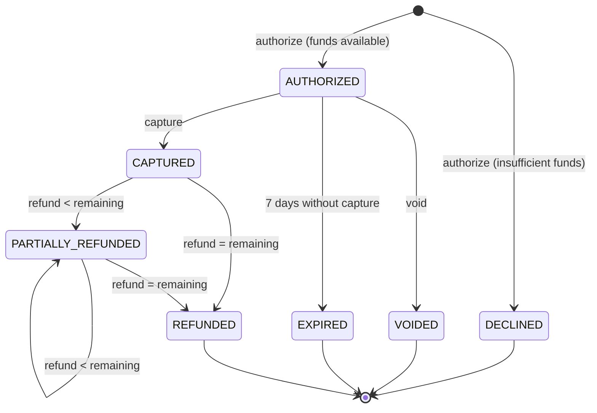

# Concepts

The ideas behind the ledger, with two worked examples. No code needed.

## Terms

| Term | Meaning |
|---|---|
| **Account** | Holds money in exactly one currency, such as Catalin's EUR wallet or the platform's fee revenue. |
| **Journal entry** | One business event, such as "transfer #42". It has two or more postings and is never changed after it's written. |
| **Posting** | One line of an entry: an account, a direction (`DEBIT` or `CREDIT`) and a positive amount. |
| **Balance** | The total of an account's postings. It's stored for fast reads and can always be recomputed from the postings. |
| **Transfer** | A deposit (money comes in), a withdrawal (money goes out) or a move between two accounts. |
| **Idempotency key** | A unique key the client sends with each request that moves money. Sending the same request again with the same key returns the first answer instead of running twice. |
| **Hold** *(planned)* | Money reserved by a card-style payment. It has left the customer's balance but hasn't reached the merchant yet. |
| **Payment** *(planned)* | A merchant charging a customer: authorize, then capture or void, then optionally refund. |

## Debits and credits

Debit and credit don't mean "add" and "remove". They're the left and right side
of an account. What they do to a balance depends on the account's **normal side**:

| Category | Normal side | Increased by | Example |
|---|---|---|---|
| Asset | Debit | Debit | Money the platform holds at its bank |
| Liability | Credit | Credit | Money the platform owes a customer or merchant |
| Revenue | Credit | Credit | Fees the platform has earned |

The ledger is the **platform's** books. A customer wallet is a liability because
the platform owes that money to the customer: if Catalin has 100 EUR in his
wallet, the platform owes Catalin 100 EUR. Crediting his wallet increases his
balance, debiting it decreases it.

Every entry debits and credits the same amount. Because of that, the books
always satisfy **Assets = Liabilities + Revenue**, and the sum of all debits
always equals the sum of all credits.

In examples, `Dr` is short for debit and `Cr` for credit.

## Chart of accounts

| Account | Code | Category | Owner |
|---|---|---|---|
| Customer wallet | - | Liability | One per customer and currency |
| Merchant balance | - | Liability | One per merchant and currency |
| Platform cash | `platform.cash.<CCY>` | Asset | Platform. Mirrors the money at the bank |
| Authorization holds | `platform.holds.<CCY>` | Liability | Platform |
| Fee revenue | `platform.fees.<CCY>` | Revenue | Platform |

The platform accounts exist once per supported currency (EUR, USD, RON) and are
created by a database migration.

## Example 1: deposit and transfer

Catalin and Bob each open an EUR wallet. Catalin deposits 100.00 EUR from his
bank, then sends 25.00 EUR to Bob. This is what `demo.sh` runs.

### Deposit

| Account | Debit | Credit |
|---|---:|---:|
| Platform cash EUR | 100.00 | |
| Catalin wallet EUR | | 100.00 |

The platform now has 100 EUR more at the bank (asset up) and owes Catalin
100 EUR (liability up). Both sides grew, and the books still balance.

### Transfer

| Account | Debit | Credit |
|---|---:|---:|
| Catalin wallet EUR | 25.00 | |
| Bob wallet EUR | | 25.00 |

| Account | Balance after |
|---|---:|
| Platform cash EUR | 100.00 |
| Catalin wallet EUR | 75.00 |
| Bob wallet EUR | 25.00 |

Assets (100.00) = liabilities (75.00 + 25.00).

### When things go wrong

| Situation | Result |
|---|---|
| The client times out and retries with the **same key and body** | `201` with the stored first response. Nothing is posted twice. |
| The client reuses the key with a **different body** | `422 idempotency-key-reused`. Nothing is posted. |
| Two requests with the same key arrive **at the same time** | The second waits for the first to finish, then gets its stored response. |
| Catalin sends two different 60.00 EUR transfers at the same time | Both need Catalin's balance, so one waits for the other. The second sees 15.00 EUR left and gets `422 insufficient-funds`. |
| Catalin -> Bob and Bob -> Catalin at the same time | Balances are always locked in the same order, so they wait instead of deadlocking. |

## Example 2: a card payment *(planned)*

Catalin (75.00 EUR after example 1) pays 25.99 EUR at Coffee Shop. Coffee Shop
pays a fee of **1.4% + 0.25 EUR** per payment.

### The payment's states



Any other step, such as capturing a voided payment, is refused with
`409 invalid-state-transition`.

### 1. Authorize 25.99 EUR

The fee is calculated now and stored on the payment:

```
2599 * 0.014 = 36.386  -> rounded HALF_EVEN -> 36
36 + 25 (fixed)        = 61 cents = 0.61 EUR
```

The money moves into the holds account. Catalin can't spend it anymore, but it
doesn't belong to Coffee Shop yet.

| Account | Debit | Credit |
|---|---:|---:|
| Catalin wallet EUR | 25.99 | |
| Authorization holds EUR | | 25.99 |

If Catalin had less than 25.99 EUR, the payment would be saved as `DECLINED`
and nothing would be posted.

### 2. Capture

One entry with three postings pays the merchant and books the fee together:

| Account | Debit | Credit |
|---|---:|---:|
| Authorization holds EUR | 25.99 | |
| Coffee Shop balance EUR | | 25.38 |
| Fee revenue EUR | | 0.61 |

Debits (25.99) = credits (25.38 + 0.61).

If the merchant voided instead, the money would go back: Dr holds 25.99,
Cr Catalin wallet 25.99. An expired authorization posts the same entry.

### 3. Refund 10.00 EUR

| Account | Debit | Credit |
|---|---:|---:|
| Coffee Shop balance EUR | 10.00 | |
| Catalin wallet EUR | | 10.00 |

The payment becomes `PARTIALLY_REFUNDED`, with 15.99 EUR still refundable.

### The books after both examples

| Account | Category | Balance |
|---|---|---:|
| Platform cash EUR | Asset | 100.00 |
| Catalin wallet EUR | Liability | 59.01 |
| Bob wallet EUR | Liability | 25.00 |
| Coffee Shop balance EUR | Liability | 15.38 |
| Authorization holds EUR | Liability | 0.00 |
| Fee revenue EUR | Revenue | 0.61 |

Assets 100.00 = liabilities 99.39 + revenue 0.61. The holds account is zero
because no authorization is open. In general it always equals the total of all
open authorizations.

### Why HALF_EVEN rounding

| Amount | Exact 1.4% fee | `HALF_EVEN` | `HALF_UP` |
|---:|---:|---:|---:|
| 2599 | 36.386 | 36 | 36 |
| 1250 | 17.5 | 18 | 18 |
| 1750 | 24.5 | **24** | 25 |

`HALF_EVEN` rounds exact halves to the nearest even number. Over many payments
that avoids always rounding in the platform's favour, which `HALF_UP` would do.
